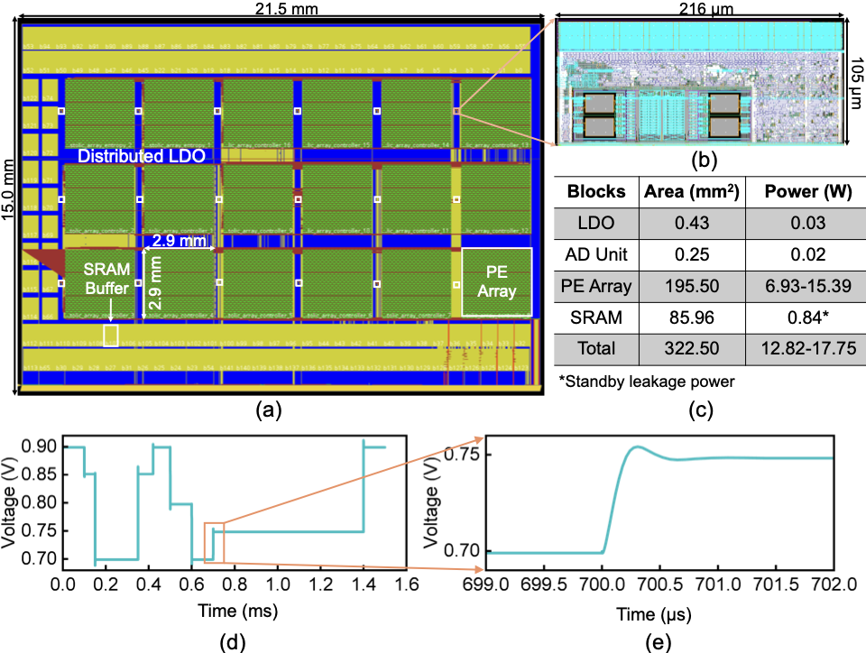
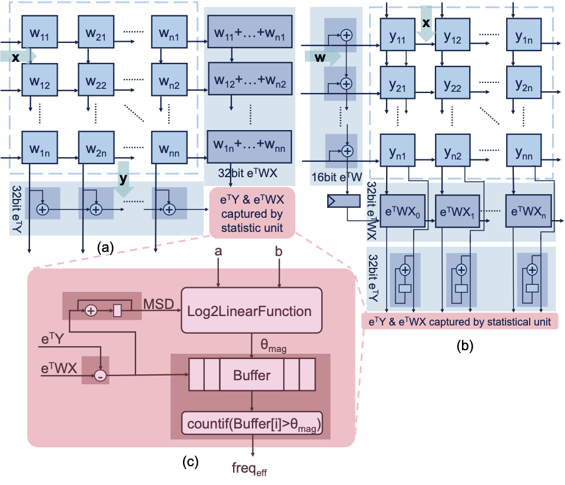
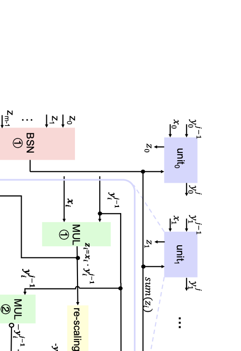
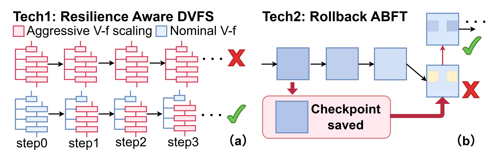
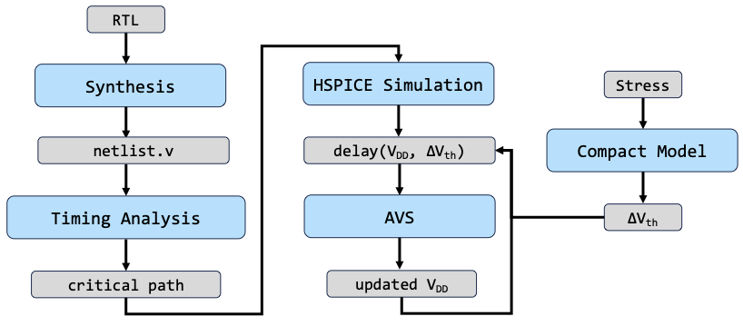

  

    
Welcome to my homepage. I am Tong Xie, a third-year Ph.D. candidate at the School of Integrated Circuits, Peking University.

    
I received the B.S. degree in Microelectronic Science and Engineering from the School of EECS at Peking University, Beijing, China, in 2024. I am currently pursuing a Ph.D. degree at the School of Integrated Circuits under the supervision of Prof. Runsheng Wang and Prof. Meng Li.

    
My research focuses on reliable and efficient AI accelerator design.

  

  <h2>Education</h2>
  

    
2024 – Present

    
Peking University, School of Integrated Circuits

    
Ph.D., Integrated Circuit Science and Engineering

    
Supervisor: Prof. Runsheng Wang and Prof. Meng Li

  

  

    
2020 – 2024

    
Peking University, School of EECS

    
B.S., Microelectronic Science and Engineering

    
GPA: 3.71/4.0 (Rank: 2)

  

  <h2>First-Author Works</h2>
  <article class="work">
    <h3 class="work__title">CREATE: Cross-layer Resilience Characterization and Optimization for Efficient yet Reliable Embodied AI Systems</h3>
    
<strong>Tong Xie</strong>, Yijiahao Qi, Jinqi Wen, Zishen Wan, Yanchi Dong, Zihao Wang, Shaofei Cai, Yitao Liang, Tianyu Jia, Yuan Wang, Runsheng Wang, and Meng Li.

    
ASPLOS 2026 <a href="https://dl.acm.org/doi/10.1145/3779212.3790147">PDF</a>

    <figure class="work__figure">
      
    </figure>
  </article>
  <article class="work">
    <h3 class="work__title">ReaLM: Reliable and Efficient Large Language Model Inference with Statistical Algorithm-based Fault Tolerance</h3>
    
<strong>Tong Xie</strong>, Jiawang Zhao, Zishen Wan, Zuodong Zhang, Yuan Wang, Runsheng Wang, Ru Huang, and Meng Li.

    
DAC 2025 <a href="https://ieeexplore.ieee.org/stamp/stamp.jsp?arnumber=11132610">PDF</a>

    <figure class="work__figure">
      
    </figure>
  </article>
  <article class="work">
    <h3 class="work__title">ASCEND: Accurate yet Efficient End-to-end Stochastic Computing Acceleration of Vision Transformer</h3>
    
<strong>Tong Xie</strong>, Yixuan Hu, Renjie Wei, Meng Li, Yuan Wang, Runsheng Wang, and Ru Huang.

    
DATE 2024 <a href="https://ieeexplore.ieee.org/stamp/stamp.jsp?arnumber=10546691">PDF</a>

    <figure class="work__figure">
      
    </figure>
  </article>
  <article class="work">
    <h3 class="work__title">DRIFT: Harnessing Inherent Fault Tolerance for Efficient and Reliable Diffusion Model Inference</h3>
    
Jinqi Wen*, <strong>Tong Xie</strong>*, Runsheng Wang, and Meng Li.

    
DAC 2026 <a href="https://doi.org/10.1145/3770743.3804042">PDF</a>

    <figure class="work__figure">
      
    </figure>
  </article>
  <article class="work">
    <h3 class="work__title">Aging Aware Adaptive Voltage Scaling for Reliable and Efficient AI Accelerators</h3>
    
<strong>Tong Xie</strong>, Zuodong Zhang, Chao Yang, Yuan Wang, Runsheng Wang, and Meng Li.

    
ISEDA 2026 <a href="https://arxiv.org/pdf/2604.09994">PDF</a>

    <figure class="work__figure">
      
    </figure>
  </article>

  <h2>Selected Honors</h2>
  

Dec 2026

Merit Student of Peking University

  

Dec 2026

Huawei Scholarship of Peking University

  

Sep 2026

<strong>Peking University President’s Scholarship</strong>

  

Dec 2025

Award for Academic Excellence at Peking University

  

Mar 2024

Outstanding Undergraduate Research Training Program Award of Peking University

  

Dec 2022

Lee Wai Wing Scholarship

  

Dec 2022

Merit Student of Peking University

  

Dec 2021

Award for Academic Excellence at Peking University

  

Oct 2019

Bronze Medal of 36th CPhO

  
For the full publication list, please visit the <a href="/publications/">Publications</a> page.

